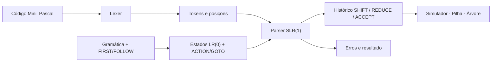

<div align="center">

# ◈ MiniPascal Studio

### Seu código, passo a passo.

**Bancada didática de compiladores · Lexer · Parser SLR(1) · Electron**

[](https://github.com/LuuizV/MiniPascalParser-Didatico/releases/latest)
[](https://github.com/LuuizV/MiniPascalParser-Didatico/releases/latest)
[](https://www.electronjs.org/)
[](https://nodejs.org/)

[](https://github.com/LuuizV/MiniPascalParser-Didatico/actions/workflows/ci.yml)
[](https://github.com/LuuizV/MiniPascalParser-Didatico/actions/workflows/build-windows.yml)

[**Baixar para Windows**](https://github.com/LuuizV/MiniPascalParser-Didatico/releases/latest) · [**Instalação**](docs/INSTALACAO.md) · [**Guia de uso**](docs/GUIA-DE-USO.md) · [**Arquitetura**](docs/ARQUITETURA.md)

</div>

---

## Apresentação

O **MiniPascal Studio** é uma ferramenta educacional para estudar a construção de compiladores. Ele une **análise léxica** e **análise sintática SLR(1)** em uma interface desktop interativa, mostrando como um programa é transformado em tokens e como esses tokens percorrem a tabela **ACTION/GOTO** até a aceitação ou a identificação de erros.

A interface foi reconstruída em **Electron, HTML, CSS e JavaScript**, mantendo a gramática e o comportamento verificado da versão Java do Lexer e Parser. O estudante pode pausar a análise, avançar, retroceder e compreender cada operação.

> **Nota de escopo:** o Parser preserva a gramática **Mini_Pascal fornecida**, que possui diferenças em relação à gramática **Sigma** apresentada no enunciado acadêmico. O programa não deve ser descrito como implementação integral de Sigma.

## Funcionalidades

| Ferramenta | O que demonstra |
|---|---|
| **Editor** | Realce de sintaxe, linhas, abertura e salvamento de arquivos. |
| **Lexer** | Tokens, lexemas, tipos, linha e coluna. |
| **Simulador SLR(1)** | SHIFT, REDUCE, ACCEPT, erro, pilha e entrada restante. |
| **Gramática** | Produções, conjuntos FIRST/FOLLOW e tabelas ACTION/GOTO. |
| **Estados LR(0)** | Itens e transições exploráveis. |
| **Árvore de derivação** | Construção visual a partir das reduções registradas. |
| **Diagnósticos** | Erros léxicos e sintáticos com navegação até o código. |
| **Apresentação** | Modo ampliado para explicações em sala de aula. |
| **Atualizações** | Verificação e instalação sob confirmação pelas Releases oficiais. |

## Início rápido

**Para usar no Windows x64:** abra a [Release mais recente](https://github.com/LuuizV/MiniPascalParser-Didatico/releases/latest) e escolha:

- **Setup (.exe):** instala o aplicativo e permite futuras atualizações automáticas, após confirmação.
- **Portable (.exe):** executa sem instalação; para atualizar, baixe uma nova cópia manualmente.

Não é necessário instalar Java, Python ou Node.js para executar o aplicativo distribuído.

**Para desenvolver:**

```bash
npm install
npm run check
npm test
npm start
```

Para compilar no Windows: `npm run dist:win`.

## Como o analisador funciona



A gramática atual reúne **71 produções** e **130 estados LR(0)**. A regressão de seis testes sintáticos reproduz **611 passos SLR(1)** da implementação Java de referência. Os testes verificam comportamento em amostras definidas; não constituem prova de correção para todos os programas possíveis.

## Atualização pelas Releases — a partir da v5.1.0

O aplicativo instalado pelo **NSIS** verifica a Release estável do GitHub ao iniciar e permite:

1. **Verificar** se há nova versão.
2. **Baixar** com indicador de progresso.
3. **Instalar e reiniciar** somente após confirmação e salvamento de alterações pendentes.

A edição Portable oferece acesso à Release, mas exige substituição manual. Quem instalou a **v5.0.0** precisa instalar **v5.1.0 manualmente uma vez**, pois a versão anterior ainda não possuía atualizador. Leia o [manual de atualizações](docs/ATUALIZACOES.md).

## Equipe e orientação acadêmica

**Universidade Estadual do Sudoeste da Bahia (UESB)** · Departamento de Ciências Exatas (DCET) · **Ciência da Computação** · Disciplina: **Compiladores**

**Discentes participantes:**
- **Luiz Vicente Gomes Jirardi**
- **Raimundo José Santiago Netto**
- **Jader Levi Nascimento Abreu Azevedo**

**Professor:** **José Carlos Martins Oliveira**

Consulte o [contexto acadêmico](docs/CONTEXTO-ACADEMICO.md) para a descrição do trabalho, seus limites e os critérios de avaliação.

## Documentação

| Documento | Conteúdo |
|---|---|
| [Instalação](docs/INSTALACAO.md) | Download, configuração, verificações e solução de problemas. |
| [Guia de uso](docs/GUIA-DE-USO.md) | Operações do simulador e atalhos. |
| [Arquitetura](docs/ARQUITETURA.md) | Componentes, fluxo SLR(1), IPC e segurança. |
| [Atualizações](docs/ATUALIZACOES.md) | Releases, latest.yml, compilação Windows e versionamento. |
| [Contexto acadêmico](docs/CONTEXTO-ACADEMICO.md) | Participantes, disciplina, requisitos e limites. |
| [CHANGELOG](CHANGELOG.md) | Histórico de versões. |

## Limitações

- O aplicativo realiza **reconhecimento léxico e sintático**, não execução ou análise semântica.
- A linguagem suportada é a **Mini_Pascal implementada**, não Sigma integral.
- A árvore pode permanecer **parcial** quando há erros com recuperação.
- O instalador ainda **não possui assinatura digital**; o SmartScreen poderá apresentar aviso.
- O pipeline testa o código e gera o executável. O fluxo completo de atualização em um computador Windows exige validação manual entre duas Releases.

---

<div align="center">

**MiniPascal Studio** · Tornando visível o processo de análise de um compilador.

[Repositório](https://github.com/LuuizV/MiniPascalParser-Didatico) · [Releases](https://github.com/LuuizV/MiniPascalParser-Didatico/releases) · [Actions](https://github.com/LuuizV/MiniPascalParser-Didatico/actions)

</div>
