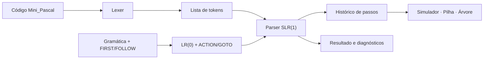

<div align="center">

# ◈ MiniPascal

### Uma bancada visual para compreender compiladores, token por token.

**Análise léxica · Análise sintática SLR(1) · Simulação interativa**

[](https://github.com/LuuizV/MiniPascalParser-Didatico/releases/latest)
[](https://www.electronjs.org/)
[](https://nodejs.org/)
[](https://github.com/LuuizV/MiniPascalParser-Didatico/releases/latest)

[](https://github.com/LuuizV/MiniPascalParser-Didatico/actions/workflows/ci.yml)
[](https://github.com/LuuizV/MiniPascalParser-Didatico/actions/workflows/build-windows.yml)

[**Baixar para Windows**](https://github.com/LuuizV/MiniPascalParser-Didatico/releases/latest) · [**Manual de instalação**](docs/INSTALACAO.md) · [**Guia de uso**](docs/GUIA-DE-USO.md) · [**Arquitetura**](docs/ARQUITETURA.md)

</div>

---

## Novidades da v5.3.0

- **Editor maior e contextual:** Novo texto, Importar arquivo e Salvar na aba Código; seletor de exemplos recolhível.
- **Análise dinâmica sincronizada:** linha do tempo, código da linha atual, cartão didático e simulador.
- **Árvore gráfica:** conexões reais em SVG, zoom, expansão, recolhimento e exportação.
- **Dados estáticos:** tokens, gramática e diagnósticos organizados em um mesmo ambiente.
- **Mais legibilidade:** fontes ampliadas, escala global persistente, ações sem duplicidade e identidade visual unificada.
- **Mais segurança para o trabalho:** proteção ao fechar com edições pendentes e análise isolada em Worker Thread.
- **Regressão preservada:** 71 produções, 130 estados LR(0), 611 passos de referência.

Consulte o [Plano de entrega v5.3.0](docs/PLANO-MESTRE-v5.3.0.md) e o [Guia de uso atualizado](docs/GUIA-DE-USO.md).

## Sobre o projeto

O **MiniPascal** é uma ferramenta acadêmica para estudar **compiladores** a partir do reconhecimento de programas em uma gramática didática de Mini_Pascal. O código é processado em duas fases integradas: um **Lexer** identifica os tokens; em seguida, o **Parser SLR(1)** consulta tabelas **ACTION/GOTO** para decidir entre *SHIFT*, *REDUCE*, *ACCEPT* e tratamento de erros.

A diferença é que o estudante pode **enxergar o processo acontecendo**: acompanhar a pilha, explorar os estados, consultar as regras e avançar ou retroceder no histórico de análise. O projeto começou em Java e foi reimplementado em **Electron, HTML, CSS e JavaScript**, preservando o comportamento verificado da gramática e do analisador fornecidos.

> **Escopo acadêmico:** o analisador reconhece a gramática **Mini_Pascal implementada no projeto**, que **não corresponde integralmente à gramática Sigma** do enunciado da disciplina. Esta distinção é intencional e está documentada nas [limitações](#limitações-e-honestidade-técnica).

## Recursos principais

| Área | O que é possível observar |
| --- | --- |
| **Editor de código** | Destaque de sintaxe, numeração de linhas, arquivos `.pas` e atalhos. |
| **Lexer** | Lexema, classificação, terminal correspondente, linha e coluna. |
| **Simulador SLR(1)** | Execução passo a passo, entrada restante, pilha e ações de análise. |
| **Tabela ACTION/GOTO** | Transições e reduções usadas pelos estados do Parser. |
| **Gramática** | Produções, conjuntos FIRST/FOLLOW e estados LR(0). |
| **Árvore de derivação** | Estrutura concreta construída com as reduções realizadas. |
| **Diagnósticos** | Erros léxicos e sintáticos, posição e navegação até o código. |
| **Atualizações** | Consulta às Releases oficiais; instalador NSIS atualizável com confirmação. |

## Comece por aqui

### Baixar e instalar no Windows

1. Abra **[Releases — MiniPascal](https://github.com/LuuizV/MiniPascalParser-Didatico/releases/latest)**.
2. Baixe **`MiniPascal-Setup-<versão>-x64.exe`** para instalar no computador e receber futuras atualizações pelo aplicativo.
3. Se preferir executar sem instalar, utilize o **`MiniPascal-Portable-<versão>-x64.exe`**, que precisa ser substituído manualmente a cada nova versão.
4. Abra o aplicativo, carregue um exemplo e clique em **Analisar código**.

**Não é necessário instalar Java, Python ou Node.js para executar o `.exe`.** Os executáveis são gerados para Windows x64 por GitHub Actions. Veja as instruções detalhadas em [Instalação](docs/INSTALACAO.md).

### Executar a partir do código-fonte

Requisitos de desenvolvimento: **Node.js 22+** e npm.

```bash
npm install
npm start
```

Para validar o núcleo e os fluxos de atualização:

```bash
npm run check
npm test
```

Para gerar os executáveis no Windows:

```bash
npm run dist:win
```

## Como funciona



A implementação atual possui **71 produções**, **130 estados LR(0)** e mantém, nos seis arquivos de regressão sintática, o mesmo histórico de **611 ações SLR(1)** comparado com a versão Java. Esses valores são referências de testes, não propriedades universais de qualquer gramática.

## Plano Mestre entre atualizações

Antes de cada versão, aplicamos o [Plano Mestre de Atualizações](docs/PLANO-MESTRE.md): diagnóstico, correções prioritárias, testes, Release validada e registro das limitações. Releases só ficam visíveis após o manifesto e instaladores estarem presentes. **Regra permanente:** cada pacote de atualização autorizado será entregue por uma Release oficial, não apenas como commit ou ZIP.

## Atualizações pelas Releases

A partir da **v5.1.0**, o instalador NSIS pode consultar a **Release estável** publicada neste repositório. O usuário decide quando baixar e quando instalar; o aplicativo não substitui seus arquivos silenciosamente.

- A consulta ocorre ao abrir o aplicativo ou manualmente no painel **Atualizações**.
- Havendo versão mais recente, é exibido um botão para **baixar** e, depois, **instalar e reiniciar**.
- O progresso fica visível. Antes de reiniciar, o editor verifica alterações não salvas.
- A edição **Portable** abre a Release oficial, pois não oferece atualização no local.
- Novas versões usam um número `vX.Y.Z`; a Release só sai de rascunho depois que instalador, portátil, `latest.yml` e hashes forem validados.

**Importante:** quem possui a v5.0.0 precisa instalar a v5.1.0 manualmente uma vez. Para que o auto-update funcione em produção, a Release precisa conter também `latest.yml` e o `.exe` NSIS. Detalhes em [Atualizações e publicação](docs/ATUALIZACOES.md).

## Interface de trabalho

O aplicativo possui apenas três áreas, sem banners promocionais ou rodapé de status:

- **Código:** editor com destaque de sintaxe, seletor recolhido de exemplos, importação TXT, ajuda, salvamento e ajustes de fonte.
- **Análise dinâmica:** linha do tempo, controles SLR(1), pilha, ações SHIFT/REDUCE e árvore de derivação no mesmo espaço.
- **Dados estáticos:** tokens, gramática (incluindo FIRST/FOLLOW e ACTION/GOTO) e erros, separados da reprodução.

Os atalhos `Ctrl+1`, `Ctrl+2` e `Ctrl+3` abrem essas áreas. O botão **Analisar código** executa a análise e abre o acompanhamento dinâmico.

## Trabalho acadêmico

**Universidade Estadual do Sudoeste da Bahia (UESB)**  
Departamento de Ciências Exatas (DCET) · Ciência da Computação · Disciplina: **Compiladores**

**Discentes:**
- **Luiz Vicente Gomes Jirardi**
- **Raimundo José Santiago Netto**
- **Jader Levi Nascimento Abreu Azevedo**

**Professor:** **José Carlos Martins Oliveira**

Este repositório apresenta uma evolução da atividade prática de análise sintática e sua integração ao analisador léxico. O [contexto acadêmico](docs/CONTEXTO-ACADEMICO.md) descreve o problema proposto, as decisões técnicas e as limitações conhecidas.

## Estrutura do repositório

```text
MiniPascalParser-Didatico/
├── assets/                 # Ícone PNG oficial
├── scripts/                # Geração de ícone ICO para Windows
├── src/
│   ├── core.cjs              # Lexer, gramática e Parser SLR(1)
│   ├── grammar.json          # Produções numeradas
│   ├── update-manager.cjs    # Estados e operações de atualização
│   ├── main.cjs              # Electron, IPC e arquivos locais
│   ├── preload.cjs           # API limitada exposta à interface
│   ├── index.html            # Interface
│   ├── renderer.js           # Simulação e navegação
│   └── style.css             # Identidade visual
├── tests/                    # Testes e programas da linguagem
├── docs/                     # Documentação técnica e acadêmica
├── .github/workflows/        # Integração contínua e Releases
├── AGENTS.md                 # Regras de desenvolvimento
└── package.json              # Dependências e distribuição
```

## Limitações e honestidade técnica

- O software **reconhece** programas, mas **não os executa** e não gera código de máquina.
- A gramática atual é **Mini_Pascal**, com diferenças em relação à especificação **Sigma** do enunciado original.
- A árvore de derivação pode ser **parcial** em programas com erros recuperados.
- A visualização de estados mostra uma **vizinhança navegável**, não os 130 estados num único desenho.
- Os testes automatizados verificam o núcleo, o histórico de análise e a máquina de estados de atualização. **A instalação real do `.exe` no Windows precisa ser validada após o build da Release.**
- Os instaladores distribuídos não possuem **assinatura de código**; o Windows SmartScreen pode exibir um aviso. Baixe somente pelas Releases oficiais e confira os hashes quando disponíveis.

## Documentação

| Documento | Conteúdo |
| --- | --- |
| [Instalação](docs/INSTALACAO.md) | Windows, portable, desenvolvimento, erros comuns. |
| [Guia de uso](docs/GUIA-DE-USO.md) | Do código à análise passo a passo. |
| [Arquitetura](docs/ARQUITETURA.md) | Lexer/Parser, IPC, estados e segurança. |
| [Atualizações](docs/ATUALIZACOES.md) | Releases, CI, `latest.yml` e atualização NSIS. |
| [Contexto acadêmico](docs/CONTEXTO-ACADEMICO.md) | Proposta, participantes, limitações e avaliação. |
| [Histórico de versões](CHANGELOG.md) | Evolução e mudanças relevantes. |

---

<div align="center">

**MiniPascal** — um projeto acadêmico para tornar o funcionamento dos analisadores léxico e sintático mais visível, verificável e compreensível.

[Repositório](https://github.com/LuuizV/MiniPascalParser-Didatico) · [Releases](https://github.com/LuuizV/MiniPascalParser-Didatico/releases) · [GitHub Actions](https://github.com/LuuizV/MiniPascalParser-Didatico/actions)

</div>
